<div align="center">

<picture>
  <source media="(prefers-color-scheme: dark)" srcset="./assets/quest-hero-dark.svg"/>
  <source media="(prefers-color-scheme: light)" srcset="./assets/quest-hero-light.svg"/>
  
</picture>

<br/>



</div>

## 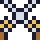 Quest Log: About

```text
NAME      : Nirmalya Mandal  (a.k.a. DevNiru2704)
CLASS     : Full-Stack Paladin
TITLE     : Co-Founder & CTO, Guildmaster of Doklink Services Pvt. Ltd.
ALSO      : Technical Director, No Strategy Studios
RACE      : Cat (60% caffeine, 40% cat energy)
ALIGNMENT : chaotic good. Fueled by pain, designed for millions.
CREED     : think of the people first, then the system design.
WEAPON    : Neovim +3   |  SHIELD: CI pipeline +5
```

I move between **frontend polish, backend plumbing, DevOps and ML** without needing a map.
Meme on the outside, **production-grade on the inside**: typed APIs, Dockerised deploys, monitoring, rollback scripts. The cat sets the vibe. The CI sets the standard.


## 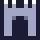 The Guild: Doklink

> ###  Co-Founder & CTO @ **Doklink Services Pvt. Ltd.**
>
> Our product, **[Doklink](https://doklink.in)**, is India's healthcare capacity optimisation platform. Emergency care shouldn't start with phone calls. Doklink shows **real-time hospital bed availability**, lets patients **reserve a bed on the way**, and gives hospital staff a **panel** to confirm arrivals, admit, discharge and keep beds current.
>
> I own the whole stack and the team shipping it: **patient mobile app**, **hospital staff panel**, **marketing site**, **backend + realtime**, and the **prod infra** underneath (containers, reverse proxy, TLS, monitoring, backups, rollbacks).
>
> `React Native · Expo` · `Next.js` · `Django REST` · `PostgreSQL` · `Redis` · `Docker` · `Nginx` · `Certbot` · `Monitoring`

<a href="https://doklink.in" target="_blank" rel="noopener noreferrer"></a>

> ###  Technical Director @ **No Strategy Studios**


<div align="center">

##  Inventory: the Stack

*every item I have actually shipped with (not a keyword salad)*


**Mage Cat: frontend spells**



**Ranger Cat: mobile**



**Paladin Cat: backend**



**Alchemist Cat: data and ML**



**Blacksmith Cat: infra and tooling**


**Scrolls: languages**


##  Character Sheet

<picture>
  
</picture>

</div>

```yaml
# active-quests.yml  (the part where the cat stops joking)
main_quests:
  - Doklink: bed booking, hospital panel, realtime backend, prod infra
  - CONTEXT: a context-aware language with an explainable interpreter

skill_tree:
  - Rust for systems tooling
  - Kernel internals and eBPF
  - LLM fine-tuning and inference optimisation

side_quests:
  - WebAssembly as a compile target for CONTEXT
  - Distributed systems primitives
```


<div align="center">

## 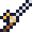 Battle Record

*the cat insists on evidence*

<table>
  <tr>
    <td>
<picture>
  <source media="(prefers-color-scheme: dark)" srcset="https://raw.githubusercontent.com/DevNiru2704/DevNiru2704/output/stats-dark.svg"/>
  <source media="(prefers-color-scheme: light)" srcset="https://raw.githubusercontent.com/DevNiru2704/DevNiru2704/output/stats-light.svg"/>
  
</picture>
    </td>
    <td>
<picture>
  <source media="(prefers-color-scheme: dark)" srcset="https://raw.githubusercontent.com/DevNiru2704/DevNiru2704/output/langs-dark.svg"/>
  <source media="(prefers-color-scheme: light)" srcset="https://raw.githubusercontent.com/DevNiru2704/DevNiru2704/output/langs-light.svg"/>
  
</picture>
    </td>
  </tr>
</table>

<picture>
  <source media="(prefers-color-scheme: dark)" srcset="https://raw.githubusercontent.com/DevNiru2704/DevNiru2704/output/streak-dark.svg"/>
  <source media="(prefers-color-scheme: light)" srcset="https://raw.githubusercontent.com/DevNiru2704/DevNiru2704/output/streak-light.svg"/>
  
</picture>


## 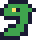 The Great Serpent Hunt


<picture>
  <source
    media="(prefers-color-scheme: dark)"
    srcset="https://raw.githubusercontent.com/DevNiru2704/DevNiru2704/output/github-contribution-grid-snake-dark.svg"
  />
  <source
    media="(prefers-color-scheme: light)"
    srcset="https://raw.githubusercontent.com/DevNiru2704/DevNiru2704/output/github-contribution-grid-snake.svg"
  />
  
</picture>


</div>

##  Loadout

| Layer         | Tool                       | Cat opinion          |
|:--------------|:---------------------------|:---------------------|
| OS            | Omarchy (Arch Linux based) | "I use Omarchy, btw" |
| WM            | Hyprland (Wayland)         | sits on it           |
| Terminal      | Kitty                      | warm, 10/10          |
| Shell         | Bash + Starship            | purrs at prompts     |
| Editor        | Neovim (LazyVim)           | no mouse, no mercy   |
| Multiplexer   | tmux                       | nine lives, nine panes |
| Containers    | Docker + Compose           | boxes. cat loves boxes. |
| Version ctrl  | Git + GitHub CLI           | `git blame cat`      |

<div align="center">


## 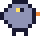 Send a Raven

<a href="https://linkedin.com/in/nirmalya-mandal-9b2475313" target="_blank" rel="noopener noreferrer"></a>
<a href="https://www.devniru.in" target="_blank" rel="noopener noreferrer"></a>
<a href="https://leetcode.com/u/wQ6wdt3C20" target="_blank" rel="noopener noreferrer"></a>
<a href="https://x.com/Nirmalya2709" target="_blank" rel="noopener noreferrer"></a>
<a href="mailto:nirmalya.mandal@outlook.com"></a>
<a href="mailto:nirmalyamandal342@gmail.com"></a>

<br/><br/>

```text
QUESTS ACCEPTED : hard problems · real collaboration · full-time roles · treats
QUESTS DECLINED : tutorial projects · spec work · unpaid consulting · dogs
```

<picture>
  <source media="(prefers-color-scheme: dark)" srcset="./assets/quest-footer-dark.svg"/>
  <source media="(prefers-color-scheme: light)" srcset="./assets/quest-footer-light.svg"/>
  
</picture>

</div>
